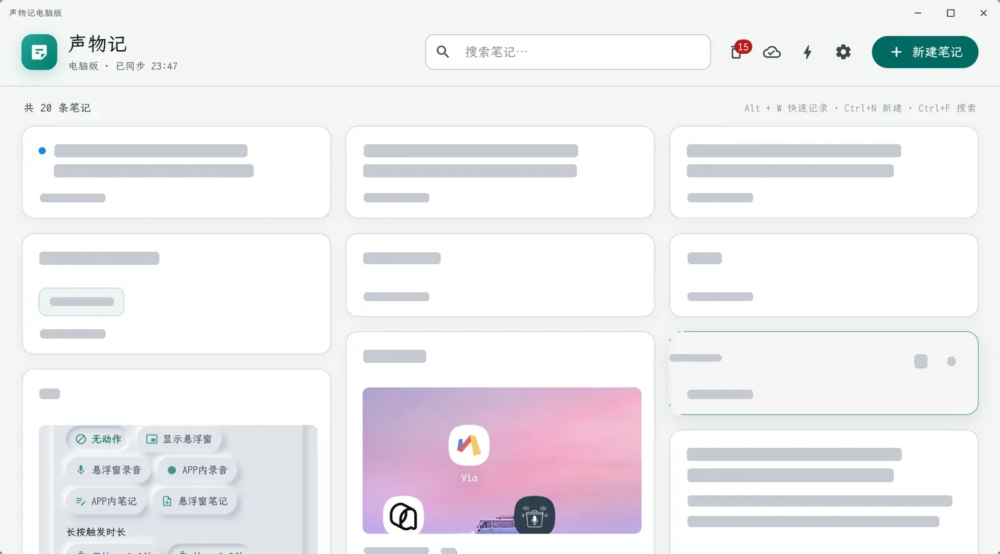
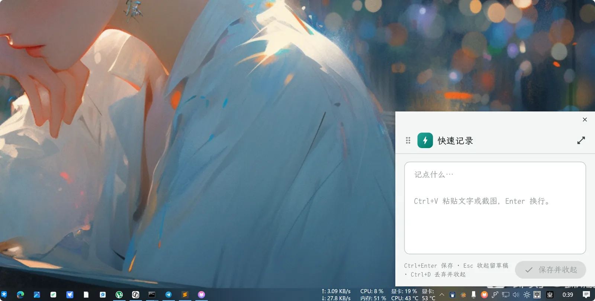
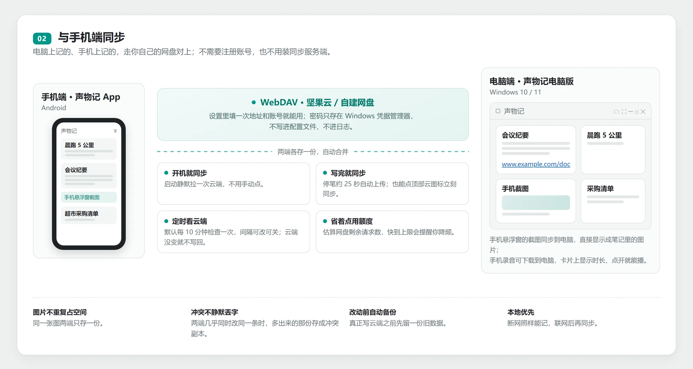
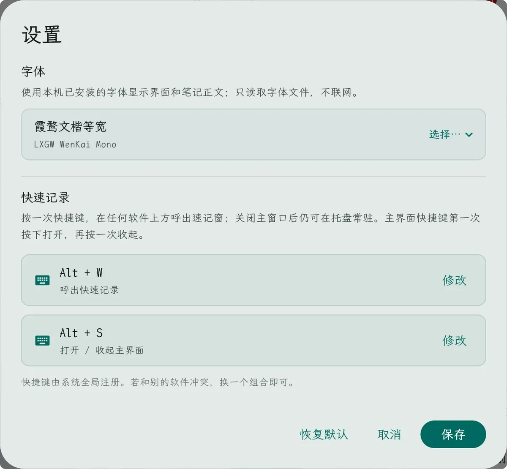
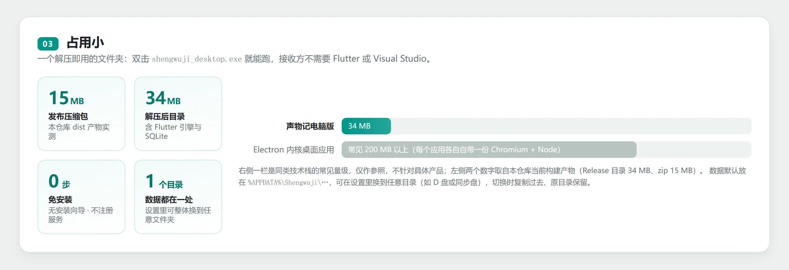

# 声物记电脑版

Windows 上的轻量本地笔记客户端。支持本地增删改查，并可通过 WebDAV 与手机端双向同步。

## 功能概览

### 主界面

瀑布流卡片按创建时间倒序，窗口变宽自动 2～4 列；顶部可搜索、进回收站、手动同步。



### 快捷悬浮窗速记

任意界面按 `Ctrl+Alt+Space`，屏幕右下角唤起置顶速记小窗；`Ctrl+Enter` 保存并收起，不打断手头的事。



### 与手机端同步

电脑上记的、手机上记的，走自己的网盘（坚果云或任意 WebDAV）对上；不需要注册账号，也不用装同步服务端。



### 外观与快捷键

浅色 / 深色 / 跟随系统，界面字体从本机已安装字体里挑，整页 80%～150% 缩放，两个全局快捷键都可改。



### 占用小

一个解压即用的文件夹，双击 exe 就能跑。



## 已实现

- 链接识别：卡片与编辑页里的网址显示为蓝色下划线，点击用默认浏览器打开且不会顺带打开笔记；
- 笔记图片：`Ctrl+V` 粘贴截图、粘贴剪贴板图片文件、按钮选择；缩略图与全屏预览，可单张移除，一条最多 12 张
- 自动保存：输入停顿 600ms 落盘，图片增删立即保存；关窗、隐藏到托盘、呼出速记窗前都先把当前编辑存下来
- 全局快捷键：`Alt+S` 唤起 / 收起主界面，`Ctrl+Alt+Space` 呼出速记窗（均可自定义，冲突时设置页拦下）；速记窗 `Ctrl+Enter` 保存、`Esc` 留草稿、`Ctrl+D` 丢弃
- 窗口：速记窗置顶，可记住拖动后的屏幕坐标，多屏失效时自动回主屏右下角
- 数据与同步：数据目录可在设置里更换；WebDAV 支持启动 / 手动 / 改动后 / 定时四种同步时机，远端 `v2/` 全量并写 `diary.json` 投影给手机端，图片按 sha256 去重，冲突生成副本，写远端前留 `sync_backup/`（最近 20 次）

## 快捷键

| 快捷键 | 作用 |
| --- | --- |
| `Ctrl+N` | 新建笔记 |
| `Ctrl+F` | 聚焦搜索 |
| `Ctrl+=` / `Ctrl+-` | 界面放大 / 缩小一档（80%～150%） |
| `Ctrl+0` | 界面缩放恢复 100% |
| `Ctrl+S` | 立即保存（编辑页） |
| `Ctrl+V` | 剪贴板有截图时作为图片附件；有文字时正常粘贴文字（编辑页与速记窗一致） |
| `Esc` | 返回列表 / 清除搜索 |
| `Ctrl+Alt+Space` | 全局呼出 / 收起快速记录（可自定义） |
| `Alt+S` | 全局打开 / 收起主界面（可自定义） |
| `Ctrl+Enter` / `Ctrl+S` | 速记窗里保存并收起 |
| `Esc` | 速记窗收起，草稿保留到下次呼出 |
| `Ctrl+D` | 速记窗丢弃当前内容并收起：正文清空、粘贴的图片文件从磁盘删除，不留草稿 |

## 数据位置

默认在应用支持目录 `%APPDATA%\Shengwuji\Shengwuji Desktop\shengwuji_desktop\`：

- `shengwuji.db`：笔记、附件索引与同步状态（SQLite）
- `blobs/`：图片与录音附件，按 sha256 存放
- `sync_backup/`：真正写远端内容前的 JSON 副本（最近 20 次；纯拉取与心跳轮次不产生）
- `notes.json` / `images/`：仅旧版 JSON 数据迁移时使用；迁移失败会退回兼容模式

`settings.json`（外观、字体、界面缩放、快速记录与主界面快捷键、速记窗位置、数据目录指针、WebDAV 地址与账号）固定留在该目录，不会跟着笔记走。
`webdav_requests.json` 记录本机最近 30 分钟的 WebDAV 请求数，用于估算坚果云额度，同样固定在配置目录。
设置 → 数据位置 → 更改… 可以把数据库与图片换到任意文件夹（如 D 盘或同步盘）：
切换时会把现有数据复制到新目录、原目录保留，立即生效；新目录里已有笔记时会先确认再切换。
外接盘暂时不可用时，启动会回退默认目录，不会卡在启动阶段。

## WebDAV 同步

设置 → WebDAV 同步里填服务器地址、账号、密码与远端目录（默认 `/shengwuji_sync`，
与手机端一致），可先「测试连接」。密码保存在 Windows 凭据管理器，不写入
`settings.json`，也不进数据库和日志。

- 启动时静默同步一次；点击顶部云图标可手动同步；本地改动后约 25 秒自动同步
- 设置页显示本机最近 30 分钟的 WebDAV 请求数，并按坚果云免费版 600 次 / 30 分钟
  估算剩余额度；达到 80% 会提醒降低检查频率或暂停同步，429 报错也会带出本机计数
- 设置里可选自动检查云端的间隔：关闭 / 5 / 10 / 15 / 30 分钟，默认 10 分钟。
  间隔到了只读 `diary.json`、`image_index.json`、`v2/notes.json`、
  `v2/tombstones.json` 的版本（4 个请求）；手机端空同步只改时间戳或本机 `rev`
  时，再读一次 `v2/notes.json` 比对内容指纹，不算变化。云端没变就结束，不加锁、
  不写远端；有变化才完整同步。完整同步内容未变时也不会重传 `v2/notes.json`、
  `v2/tombstones.json`、`v2/manifest.json`，各设备的 `last_seen` 心跳也不触发写回
- 远端以 `v2/` 为准（完整数据），同时写 `diary.json` 投影给手机端 v17 读取
- 图片随笔记同步到 `v2/assets/`，按 sha256 去重，单张上限 20 MB
- 手机端截图经 `image_index.json` 索引同步到电脑（电脑端挂为笔记的图片附件）；
  电脑端自己粘贴的图片仍不会出现在手机上（手机 v17 不读 `v2/assets/`）
- 手机端录音默认只同步「有录音」的信息；在设置里开启「同步录音」后会从
  `audio/` 下载到本机，卡片显示时长，打开笔记即可播放（单条上限 100 MB）
- 双方都修改且时间接近时，输家内容生成「冲突副本」，不静默丢字
- 远端协议版本高于本机支持范围时中止，不覆盖任何文件

已知边界（与手机端 v17 的既有行为一致）：

- 手机端只读 `diary.json`，看不到桌面端的编辑与删除；桌面端删掉的笔记仍会出现在手机端
- 手机端删除的笔记不会通知桌面端
- 桌面端没有录音功能，因此不会向云端上传新录音；只下载并播放手机端录音
- 同步锁是手机端同款软锁（10 分钟过期），两台设备极端同时点击可能重复上传，但不会损坏数据
- 坚果云不提供查询剩余额度的接口，桌面端只能统计自己发出的请求；手机端和其它
  客户端的请求不计入，实际剩余可能更少。触发限流后服务端可能封锁数小时
- 手机端 v17 不读取 `v2/assets/`，所以桌面端图片不会出现在手机上（反过来，手机截图可以同步到桌面）

## 运行

```bash
flutter pub get
flutter run -d windows
```

需要 Visual Studio 的「使用 C++ 的桌面开发」工作负载（含 CMake 工具与 Windows 10/11 SDK）。
音频播放插件 `audioplayers_windows` 首次构建会通过 NuGet 拉取 WIL，需要联网；
仓库根目录的 `NuGet.Config` 确保 `nuget.org` 源可用，不会改动系统的全局 NuGet 配置。

## 打包发布

双击 `scripts\package_windows.bat`（或在 PowerShell 里运行 `scripts\package_windows.ps1`）即可一次完成：
构建 release → 自动查找并复制 VC++ 运行库（`msvcp140.dll` / `vcruntime140.dll` / `vcruntime140_1.dll`）→ 压缩成 zip。
产物在 `dist\shengwuji_desktop-v<版本>-windows-x64.zip`，版本号取自 `pubspec.yaml`（可加 `-Version 0.1.1` 覆盖）。

- 任何一步失败都会以非 0 退出码结束、打印原因，bat 窗口会停住等按键，不会一闪而过
- 运行库通过 vswhere 查找已安装的 Visual Studio（自定义安装盘符也能找到）；找不到时用 `-VcRuntimeDir` 指定 `...\x64\Microsoft.VC142.CRT`
- 接收方不需要 Flutter / Visual Studio，解压后双击 `shengwuji_desktop.exe` 即可

## 应用图标

窗口、任务栏与 exe 图标用 `windows/runner/resources/app_icon.ico`，托盘图标用 `assets/tray_icon.ico`。
两者都来自手机端的 `assets/icon/app_icon.png`：源图四角是白底，图标文件里按圆角边裁成透明，
再生成多尺寸 ICO（exe 为 16～256，托盘为 16～64）。去白底后的 1024px 主图留在
`assets/app_icon.png`，不参与打包，只作图标源文件。

## 后续

- `v2/items.json`、`v2/tags.json` 的合并与手机端物品/标签同步
- 桌面端录音与音频上传（目前只下载/播放手机端录音）
- 手机端升级到 v2 后，编辑与删除跨端收敛
- Markdown 导出到 Obsidian
- 自绘标题栏的拖拽目前走 `startDragging()`，能移动窗口但不触发贴边 Aero Snap（Win+方向键仍可用），顶部边缘也不能再拖拽缩放；要补齐需在原生层给标题栏区域返回 `HTCAPTION`

详细接口与边界见 [docs/README.md](docs/README.md)（数据库与同步规范）。

## 灵感来源

本项目的灵感来自 [QUICKnote](https://github.com/xy1255/QN_quick-note) —— xy1255 的 Windows 轻量桌面笔记工具。

## 许可证

源码与文档以 Apache License 2.0 授权，全文见 [LICENSE](LICENSE)。
